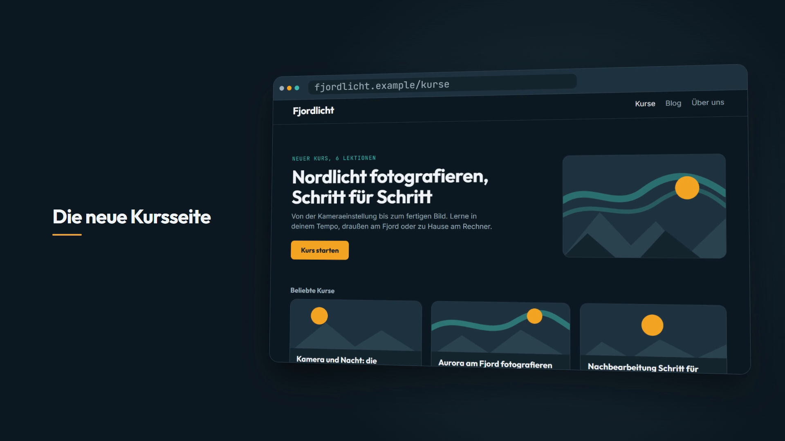

# Räumliche Website-Vorschau (floating-preview)

Eine leicht gedrehte Karte im Raum mit Browser-Leiste, URL-Chip und einem Screenshot, der langsam
scrollt. Links steht eine kurze Headline. Die Karte fliegt ein, driftet durch zwei Posen und fliegt
wieder aus. Die Komposition ist 10 s lang, 1920 x 1080, 30 fps.



## Wofür du sie nutzt

- Um eine Website, App oder ein Tool zu zeigen, während du darüber sprichst.
- Statt eines flachen Screenshots, der einfach eingeblendet wird.
- Mit einem Video statt eines Bildes, zum Beispiel einem kurzen Bildschirm-Mitschnitt (siehe unten).

## Ablauf

| Zeit | Was passiert |
| --- | --- |
| 0 bis 1,2 s | Karte steigt aus 80 px Tiefe auf, dreht von -22 auf -14 Grad, wächst von 92 auf 100 Prozent |
| 0,8 s | Headline gleitet von links ein |
| 1,2 bis 4,5 s | langsame Drift in die zweite Pose (flacher, etwas nach links) |
| 1,5 bis 7,5 s | der Screenshot in der Karte scrollt langsam nach oben (höchstens 220 px) |
| 4,5 bis 7,5 s | Drift in die dritte Pose |
| ab 8,1 s | Headline blendet aus |
| 8,6 bis 9,7 s | Karte fliegt nach oben aus, bei 10 s ist nur der Grund zu sehen |

Technik: CSS-3D (`perspective` am Wrapper, `transform-style: preserve-3d`) plus GSAP auf
`rotationY`, `rotationX`, `x`, `y`, `scale`. Eine pausierte Timeline, deterministisch bei jedem Frame.

## Variablen

| id | Typ | Standard | Bedeutung |
| --- | --- | --- | --- |
| `mediaSrc` | string | `assets/demo-website.png` | Pfad zum Bild in der Karte, relativ zu diesem Ordner |
| `caption` | string | `fjordlicht.example/kurse` | Text im URL-Chip der Browser-Leiste |
| `title` | string | `Die neue Kursseite` | Headline links neben der Karte |

Beispiel mit eigenem Screenshot:

```bash
node scripts/render.mjs floating-preview --vars "{\"mediaSrc\":\"assets/mein-screenshot.png\",\"caption\":\"meine-seite.de\",\"title\":\"Meine neue Seite\"}"
```

## Eigenes Medium

- **Bild:** Lege einen Screenshot nach `library/floating-preview/assets/` (oder in den Grafik-Ordner
  deines Projekts). Am besten 1600 x 1000 (16:10) oder höher. Ein höheres Bild scrollt weiter,
  maximal 220 px. PNG oder JPG.
- **Video statt Bild:** Ersetze im `index.html` das `` durch
  `<video id="media" muted playsinline data-var-src="mediaSrc" src="assets/mein-clip.mp4"></video>`.
  Das Video bekommt kein eigenes `data-start`, weil der umgebende Clip `card-clip` schon getimt ist
  (Lint-Regel `video_nested_in_timed_element`: Timing am Wrapper **oder** am Video, nie an beiden).
  Kein `crossorigin`, kein `play()` im Script; Hyperframes steuert die Wiedergabe. Lass den Clip
  `muted`, Ton kommt im Schnitt aus der Sprachspur.

Das Medium ist ein festes Bild. Es behält seine eigenen Farben, auch wenn du die Marke wechselst.
Im hellen Demo-Treatment bleibt der Screenshot deshalb dunkel; das ist gewollt.

## Wie das Demo-Medium entstanden ist

`assets/demo-website.png` (1600 x 1000) ist selbst gerendert aus `demo-source/index.html`, einer
kleinen Hyperframes-Komposition mit einer erfundenen Website der Demo-Marke "Fjordlicht" (Navigation,
Hero, Button, drei Kurskarten mit Inline-SVG-Formen). Keine fremden Bilder, keine Logos. Neu erzeugen:

```bash
cd library/floating-preview/demo-source
npx --yes hyperframes@0.8.199 render --output demo.mp4 --quality looks
ffmpeg -y -v error -ss 0.5 -i demo.mp4 -frames:v 1 ../assets/demo-website.png
```

## Dauer ändern

Die Dauer ist nicht an eine Variable gebunden. Du änderst sie in `index.html`:

1. `data-duration="10"` am Root-Element.
2. `data-duration="9.7"` am Clip `card-clip` (soll 0,3 s vor dem Ende enden) und `data-duration="7.8"`
   am Clip `title-clip` (beginnt bei 0,8 s).
3. Im Script die Ausgangszeiten `8.6` (Karte) und `8.1` (Headline) sowie die Dauer der Drift-Posen.
   Faustregel: Ausgänge auf `Gesamtlänge - 1.4` und `Gesamtlänge - 1.9` setzen.

## Rendern

Im Paket-Stammordner:

```bash
node scripts/render.mjs floating-preview --quality looks --png 3
```

Ausgabe: `library/floating-preview/previews/floating-preview.mp4`. Prüfen:

```bash
cd library/floating-preview
npx --yes hyperframes@0.8.199 check
```

## An die eigene Marke anpassen

Im Quelltext änderst du nichts. Farben, Schriften, Radien und Abstände kommen aus dem Token-Block in
`index.html` (erzeugt aus `brand/tokens.json` mit `node scripts/build-tokens.mjs`):

- `--color-bg` und `--color-surface-2` Hintergrund und Leuchten, `--color-surface` Browser-Leiste
- `--color-line` Kartenrand, `--color-muted`, `--color-accent`, `--color-accent-2` die drei Punkte der Leiste
- `--color-accent` Linie unter der Headline, `--color-text` Headline und URL
- `--font-display` Headline, `--font-mono` URL-Chip, `--radius-md` Karte

Beweis mit dem zweiten Demo-Treatment:

```bash
node scripts/render.mjs floating-preview --quality looks --tokens brand/examples/tokens-alt-demo.json --output library/floating-preview/previews/alt-brand.mp4 --png 3
```
