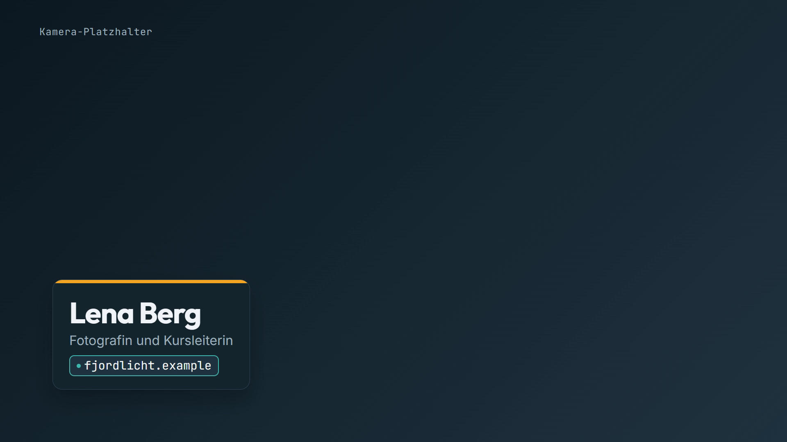

# Lower Third (Sprecherkarte)

Eine Bauchbinde unten links: Akzentbalken, Name, Rolle und ein kleiner Tag-Chip. Die Karte blendet zwischen 0,3 s und 1,5 s ein, steht lesbar bis 6,6 s und ist bei 7,7 s wieder komplett weg. Die Komposition ist 8 s lang, 1920 x 1080, 30 fps.



## Wofuer du sie nutzt

- Um eine Sprecherin oder einen Sprecher in einem Kamera-Video vorzustellen (Name und Funktion).
- Als transparentes Overlay ueber einem fertigen Schnitt (siehe unten, `--format webm`).
- Als Vorlage fuer eigene Karten: Layout und Timing stehen in einer Datei, Farben und Schriften kommen aus den Marken-Tokens.

Die Karte sitzt im 90-Prozent-Action-Safe-Bereich (Ankerpunkt x = 128 px, Unterkante y = 1080 - 128 px). Oben links liegt ein kleines Label "Kamera-Platzhalter" auf einem ruhigen Verlauf. Dieser Demo-Hintergrund steht fuer das spaetere Kamerabild und laesst sich per Variable abschalten.

## Dateien

| Datei | Inhalt |
| --- | --- |
| `index.html` | Die Komposition (Markup, Layout, GSAP-Timeline). |
| Token-Block in `index.html` | Der Bereich zwischen `brand-tokens:start` und `brand-tokens:end`. Erzeugt von `node scripts/build-tokens.mjs` aus `brand/tokens.json`, nicht von Hand aendern. |
| `preview.png` | Einzelbild bei 3,5 s aus dem gerenderten MP4. |
| `previews/` | Render-Ausgaben und Pruef-Frames (werden bei jedem Render neu erzeugt). |

## Variablen

| id | Typ | Standard | Bedeutung |
| --- | --- | --- | --- |
| `name` | string | `Lena Berg` | Name in der Display-Schrift, erste Zeile. |
| `role` | string | `Fotografin und Kursleiterin` | Rolle oder Funktion, zweite Zeile in `--color-muted`. |
| `tag` | string | `fjordlicht.example` | Kurzer Zusatz im Mono-Chip, zum Beispiel Website, Handle oder Ort. |
| `showBackdrop` | boolean | `true` | Zeigt den Demo-Hintergrund (Verlauf plus Label). Auf `false` setzen, wenn du die Karte als Overlay renderst. |

Die Texte sind mit `data-var-text` an die Elemente gebunden. `showBackdrop` wird einmal beim Start ueber `window.__hyperframes.getVariables()` gelesen. Fehlt die API (zum Beispiel beim direkten Oeffnen der Datei im Browser), gelten die Standardwerte.

Werte uebergibst du beim Render als JSON:

```bash
node scripts/render.mjs lower-third --vars "{\"name\":\"Max Muster\",\"role\":\"Testrolle\",\"tag\":\"example.org\"}"
```

Oder aus einer Datei: `--vars-file meine-werte.json`.

## Rendern

Alle Befehle laufen im Paket-Stammordner (dort, wo `package.json` liegt).

```bash
# Vorschau in Standardqualitaet, dazu ein Einzelbild bei 3,5 s
node scripts/render.mjs lower-third --quality looks --png 3.5

# Schnell (Entwurf) oder final (Auslieferung)
node scripts/render.mjs lower-third --quality draft
node scripts/render.mjs lower-third --quality delivery

# Pruefen, ob die Komposition dem Hyperframes-Vertrag entspricht
cd library/lower-third
npx --yes hyperframes@0.8.199 check
```

Die Ausgabe landet in `library/lower-third/previews/lower-third.mp4`. Mit `--output <pfad>` waehlst du einen anderen Zielpfad.

## Als Overlay nutzen

Fuer ein transparentes Overlay ueber deinem eigenen Schnitt schaltest du den Demo-Hintergrund ab und renderst als WebM mit Alphakanal:

```bash
node scripts/render.mjs lower-third --format webm --vars "{\"showBackdrop\":false,\"name\":\"Max Muster\",\"role\":\"Testrolle\"}" --output projects/mein-projekt/graphics/lower-third.webm
```

Der Body hat bewusst keinen eigenen Hintergrund. Nur der Hintergrund-Block `#backdrop` fuellt die Flaeche, und der ist bei `showBackdrop=false` per Klasse `is-hidden` ausgeblendet. So bleibt alles ausser der Karte transparent.

## Dauer aendern

Die Dauer ist nicht an eine Variable gebunden (Hyperframes liest `data-duration` aus dem Markup, nicht aus Variablen). Du aenderst sie an drei Stellen in `index.html`:

1. `data-duration="8"` am Root-Element `<div id="root" ...>`: die Gesamtlaenge in Sekunden.
2. `data-duration="7.5"` am Clip `<section id="card" ...>`: der Clip beginnt bei 0,3 s und soll 0,2 s vor dem Ende des Roots enden (also `Gesamtlaenge - 0.5`).
3. `var EXIT_START = 6.6;` im Script am Ende der Datei: ab hier blendet die Karte aus, das Ausblenden dauert 1,1 s. Setze `EXIT_START = Gesamtlaenge - 1.4`.

Beispiel fuer 12 s: Root `data-duration="12"`, Clip `data-duration="11.5"`, `EXIT_START = 10.6`.

Die Einblendung beginnt bei `ENTER_START = 0.3` und ist nach 1,2 s abgeschlossen. Eases: `power3.out` beim Einblenden, `power3.in` beim Ausblenden.

## An die eigene Marke anpassen

Im Quelltext aenderst du dafuer nichts. Alle Farben, Schriften, Radien und Abstaende kommen aus dem Token-Block, also aus `brand/tokens.json`:

- `--color-surface` und `--color-text` fuer die Karte und den Namen
- `--color-muted` fuer die Rolle und das Label des Demo-Hintergrunds
- `--color-accent` fuer den Balken an der Oberkante
- `--color-accent-2` fuer Rahmen und Punkt des Tag-Chips, `--color-surface-2` als Chip-Fuellung
- `--color-line` fuer die feine Kontur der Karte
- `--font-display`, `--font-body`, `--font-mono` fuer Name, Rolle und Chip
- `--radius-md`, `--radius-sm`, `--space-*`, `--type-*` fuer Form und Groessen

Nach `node scripts/build-tokens.mjs` traegt die Karte deine Marke. Beweis mit dem zweiten Demo-Treatment (hell, Serifen, Koralle):

```bash
node scripts/render.mjs lower-third --quality draft --tokens brand/examples/tokens-alt-demo.json --output library/lower-third/previews/alt-brand.mp4 --png 3.5
```

Das Skript setzt die alternativen Tokens nur in eine temporaere Render-Kopie (`.render-index.html`) ein und loescht sie danach. `index.html` bleibt byte-gleich; der Wrapper meldet dazu den Hash der Datei.
