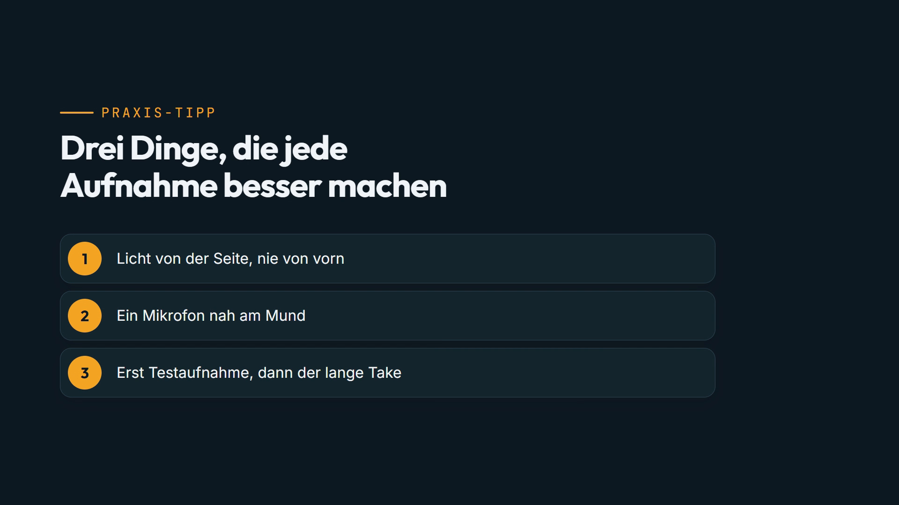

# Punkt-Grafik (point-graphic)

Eine bildfüllende Erklärgrafik: kleiner Kicker, Titel, darunter drei nummerierte Punkte, die
nacheinander erscheinen. Die Komposition ist 10 s lang, 1920 x 1080, 30 fps.



## Wofür du sie nutzt

- Für eine gesprochene Passage, in der du zwei bis vier Dinge aufzählst oder vergleichst.
- Als Zwischenbild in einem Schnitt, während die Kamera klein oben rechts läuft oder ganz weg ist.
- Als Vorlage für eigene Erklärgrafiken: Layout und Timing stehen in einer Datei, Farben und
  Schriften kommen aus den Marken-Tokens.

Alles liegt im Action-Safe-Bereich (links 128 px, mindestens 54 px oben und unten).

## Ablauf

| Zeit | Was passiert |
| --- | --- |
| 0,3 s | Kicker-Linie wächst, Kicker-Text gleitet ein |
| 0,6 s | Titel erscheint |
| 1,8 s / 3,0 s / 4,2 s | Punkt 1, 2, 3: Karte gleitet 40 px nach oben und blendet ein, die Nummer wächst aus 60 Prozent |
| bis 8,6 s | alles steht lesbar |
| 8,6 bis 9,8 s | alles blendet mit leichter Aufwärtsbewegung aus, bei 10 s ist nur der Grund zu sehen |

Eases: `power3.out` beim Einblenden, `power3.in` beim Ausblenden.

## Variablen

| id | Typ | Standard | Bedeutung |
| --- | --- | --- | --- |
| `label` | string | `Praxis-Tipp` | Kicker über dem Titel, wird in Großbuchstaben gesetzt |
| `title` | string | `Drei Dinge, die jede Aufnahme besser machen` | Titel, darf zweizeilig umbrechen |
| `point1` | string | `Licht von der Seite, nie von vorn` | Erster Punkt |
| `point2` | string | `Ein Mikrofon nah am Mund` | Zweiter Punkt |
| `point3` | string | `Erst Testaufnahme, dann der lange Take` | Dritter Punkt |

Die Texte sind mit `data-var-text` gebunden. Werte übergibst du beim Render als JSON:

```bash
node scripts/render.mjs point-graphic --vars "{\"title\":\"So klingt dein Ton besser\",\"point2\":\"Pegel bei minus 12 dB\"}"
```

Halte jeden Punkt bei einer Zeile (etwa 45 Zeichen). Längere Punkte brechen um und die Karte wird höher.

## Weniger oder mehr Punkte

In `index.html` steht jeder Punkt als eigener Clip `<section id="point-1" class="clip" ...>` bis `point-3`.

- **Zwei Punkte:** Den Block `<section id="point-3" ...> ... </section>` löschen. Im Script
  `pointTimes` auf `[1.8, 3.0]` kürzen und `"#point-3 .card"` aus `exitTargets` entfernen. Die
  Variable `point3` aus `data-composition-variables` entfernen.
- **Vier Punkte:** Den Block von `point-3` kopieren, `id="point-4"`, `data-start="5.4"`,
  `data-duration="4.6"`, Nummer `4` und `data-var-text="point4"` setzen. Im Script `5.4` an
  `pointTimes` anhängen, `"#point-4 .card"` an `exitTargets` anhängen und eine Variable `point4`
  deklarieren. Prüfe danach mit `check`, ob alles in den sicheren Bereich passt.

Jeder Punkt-Clip endet bei 10 s (`data-start + data-duration = 10`).

## Dauer ändern

Die Dauer ist nicht an eine Variable gebunden. Du änderst sie in `index.html`:

1. `data-duration="10"` am Root-Element `<div id="root" ...>`.
2. `data-duration` an jedem Clip (`kicker-clip`, `title-clip`, `point-1` bis `point-3`), so dass jeder
   Clip mit der neuen Gesamtlänge endet.
3. Im Script die Startzeit des Ausgangs (`8.6` in der Zeile mit `tl.to(exitTargets, ...)`): setze sie auf
   `Gesamtlänge - 1.4`.

## Rendern

Im Paket-Stammordner:

```bash
node scripts/render.mjs point-graphic --quality looks --png 5.5
```

Die Ausgabe landet in `library/point-graphic/previews/point-graphic.mp4`. Prüfen:

```bash
cd library/point-graphic
npx --yes hyperframes@0.8.199 check
```

## An die eigene Marke anpassen

Im Quelltext änderst du nichts. Alle Farben, Schriften, Radien und Abstände kommen aus dem
Token-Block in `index.html` (erzeugt aus `brand/tokens.json` mit `node scripts/build-tokens.mjs`):

- `--color-bg` Hintergrund, `--color-surface` Karten, `--color-line` Kartenrand
- `--color-accent` Kicker und Nummern-Badges, `--color-on-accent` Ziffer im Badge
- `--color-text` Titel und Punkte
- `--font-display` Titel und Ziffern, `--font-body` Punkte, `--font-mono` Kicker
- `--radius-md`, `--radius-sm`, `--space-*`, `--type-*` für Form und Größen

Beweis mit dem zweiten Demo-Treatment (hell, Serifen, Koralle):

```bash
node scripts/render.mjs point-graphic --quality looks --tokens brand/examples/tokens-alt-demo.json --output library/point-graphic/previews/alt-brand.mp4 --png 5.5
```
